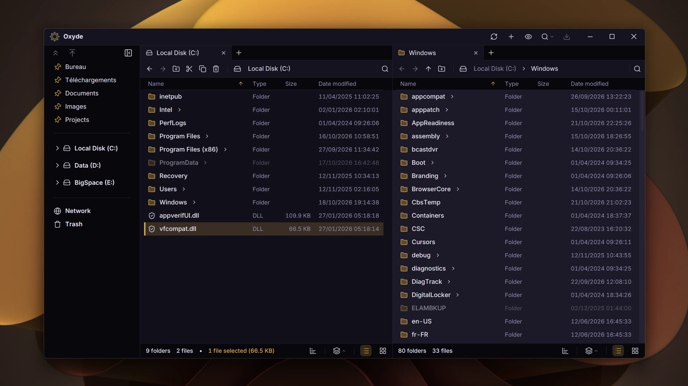

# Oxyde

<p align="center">
  
</p>

Oxyde is a native file manager built in **Rust**, with a **GPUI** interface and **Tokio** for background work. It combines flexible multipane browsing, integrated previews, advanced search, and file operations in a customizable desktop workspace.

Windows is the current distribution target. Linux platform code is also present, but the Linux build and runtime are not currently validated, and some native integrations are Windows-only.

## From Tauri to GPUI

Oxyde has migrated from a Tauri application with a React and TypeScript frontend to a Rust application using **GPUI**, the GPU-accelerated UI framework developed for Zed. The migration replaces the webview and JavaScript frontend with native rendering and brings interface state, application logic, and background services into one language. It removes the Rust-to-JavaScript bridge from UI interactions and gives the project direct control over rendering, focus, virtualized lists, and native windows. Together with Tokio background tasks and dedicated worker processes, this foundation supports richer integrated previews and keeps file access and expensive processing off the UI thread.

The migration also brought substantial security hardening: on Windows, archive codecs, image decoding, and Office text extraction now run in restricted worker processes, with resource limits and explicit validation of worker responses. Stronger checks around file identity, archive paths, and output publication further protect file operations. The [security documentation](docs/security/status.md) describes these protections and their current scope.

## Key Features

- **Flexible Multipane Workspace**: Browse multiple locations in resizable panels, rearrange tabs and panels, and drag files between locations. Restore your tabs, layout, and window geometry between sessions.
- **Tabbed Browsing**: Duplicate tabs, open folders with a middle click, and switch locations independently in each panel.
- **List and Thumbnail Views**: Browse virtualized file lists or thumbnail grids, with natural filename sorting, date grouping, and controls for hidden and system files.
- **Integrated Viewer**: Follow the current selection in a dedicated panel or detach it into a resizable window. View full-resolution images, multipage PDFs, text and source code with syntax highlighting, rendered Markdown, and text from Office Open XML and OpenDocument files. Play audio and video with system codecs on Windows, with album artwork and media navigation.
- **Hover Previews**: Inspect supported images, documents, and media directly from file tooltips, without opening another application. PowerToys Peek remains available as an optional Windows integration.
- **Advanced Search**: Search recursively by name, use wildcard and regular expression criteria, search file contents, and narrow results by date and size. Browse incoming results while the search runs, or stop it and keep the results already found.
- **Duplicate Search**: Compare files by name, size, content, or combined criteria across multiple locations.
- **File Operations Manager**: Track transfers and other operations in a dedicated window with progress, throughput graphs, pause and cancellation controls, and per-item results. Resolve destination conflicts before transfers begin, and undo or redo supported file operations during the session.
- **Turbo Mode**: Adjust operation priority and use additional parallelism where supported, including storage-aware file transfers and ZIP, 7z, and Zstandard compression.
- **Archive Browsing and Editing**: Browse and extract supported archives, search archive names and metadata, and create or modify ZIP, 7z, TAR, and TAR.ZST archives from the workspace.
- **Disk Images**: Browse ISO9660 ISO/IMG images directly, with native Windows mounting and unmounting for supported disk images, including VHD/VHDX.
- **Recycle Bin and Network Drives**: Browse and restore recycled items, manage Recycle Bin settings, and map or disconnect network drives on Windows.
- **Dedicated Workers**: On Windows, archive codecs, image decoding, and Office text extraction run in restricted worker processes with resource limits. See the [security documentation](docs/security/status.md) for the scope and remaining limits.
- **Themes and Languages**: Choose from thirteen themes, including GitHub, Ayu, Monokai, and Solarized, adjust UI scale, and use Oxyde in English, French, Spanish, German, or Italian.
- **Updates and Portable Distribution**: Install signed update packages from GitHub releases through the installed Windows edition, or use a portable ZIP that keeps preferences, session data, and caches alongside the application. Portable users update from the releases page.

## Technology Stack

- **Application and UI**: Rust and [GPUI](https://github.com/zed-industries/zed/tree/main/crates/gpui), with GPU-accelerated native rendering.
- **Background Work**: Tokio, dedicated worker processes, and asynchronous filesystem monitoring.
- **System Integration**: A shared `Platform` abstraction with target-specific implementations.
- **Localization**: Fluent translation catalogs for five languages.
- **Icons**: Official [Lucide](https://lucide.dev/) SVG assets.

## Getting Started

### Prerequisites

For the current Windows build:

- [Rust](https://www.rust-lang.org/tools/install) with the MSVC x64 toolchain.
- Visual Studio Build Tools with the Visual C++ build tools and Windows SDK.

### Build and Run

From the repository root, with Oxyde closed:

```powershell
cargo build --bins
cargo run
```

Build all binaries before launching: `cargo run` alone does not rebuild the auxiliary workers. Keep the three worker executables alongside the main executable. Once dependencies are cached, add `--offline` to these commands to build without network access.

### Release Build and Packaging

```powershell
cargo build --release --bins
```

To assemble a portable ZIP or a Windows installer, follow the [distribution guide](docs/guides/distribution.md), which covers packaging prerequisites, bundled licenses, and update behavior.

For development checks and tests, see the [development guide](docs/guides/development.md).

## Keyboard Shortcuts

These shortcuts apply while the file panel has keyboard focus.

| Navigation and Focus | Shortcut |
| --- | --- |
| Switch between explorer panels | Tab / Shift + Tab |
| Go back, or up if there is no history | Backspace |
| Go to the parent directory | Alt + Up |
| Open the selected folder or file | Enter |
| Open quick search | Ctrl + F |
| Add a panel | Ctrl + N |
| Open a folder in a new tab | Middle click |

| File Operations | Shortcut |
| --- | --- |
| Copy / Cut / Paste | Ctrl + C / X / V |
| Copy full paths | Ctrl + Shift + C |
| Copy names | Ctrl + Alt + C |
| Create a folder | Ctrl + Shift + N |
| Move to the Recycle Bin | Delete |
| Delete permanently | Shift + Delete |
| Rename | F2 |
| Select all / Deselect all | Ctrl + A / Ctrl + Shift + A |
| Show properties | Alt + Enter |
| Undo / Redo supported operations | Ctrl + Z / Ctrl + Y or Ctrl + Shift + Z |

| Tabs and View | Shortcut |
| --- | --- |
| Next tab | Ctrl + Tab or Ctrl + PageDown |
| Previous tab | Ctrl + Shift + Tab or Ctrl + PageUp |
| Refresh | F5 or Ctrl + R |
| Increase / Decrease UI scale | Ctrl + Plus / Minus |
| Reset UI scale | Ctrl + 0 |

PowerToys Peek uses its configured activation shortcut; Space is available when enabled in Peek. In the media Viewer, Space toggles playback, and Left / Right navigate images or videos of the same type.

## Note on Contributions

Oxyde is a personal project developed for educational purposes and personal use. To maintain creative control and a manageable development pace, **I am not currently accepting pull requests or external contributions** to this repository.

However, since this project is licensed under the **GNU GPL v3**, you are more than welcome to fork the repository, experiment with the code, and build your own versions of the application.

## Documentation

Technical documentation is available in [docs/](docs/README.md), with dedicated guides for [development](docs/guides/development.md), [Windows distribution](docs/guides/distribution.md), and [security protections and limits](docs/security/status.md).

## License

This project is licensed under the **GNU GPL v3**. See the [LICENSE](LICENSE) file for details.

Developed with passion by **Carlton2001**.
