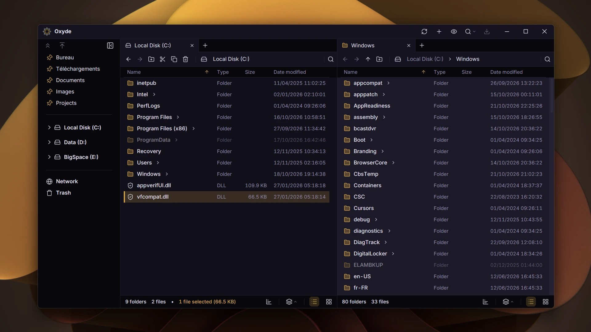
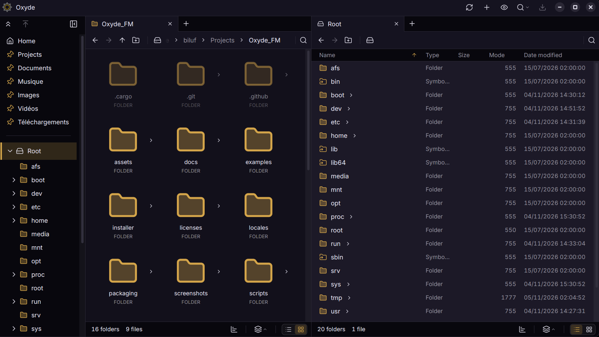

# Oxyde

<p align="center">
  
</p>

Oxyde is a native file manager built in **Rust**, with a **GPUI** interface and **Tokio** for background work. It combines flexible multipane browsing, an integrated viewer, advanced search, archives and tracked file operations in a customizable desktop workspace.

Oxyde runs on **Windows 10 and 11** and, since version 2.1, on **Linux** (x86-64, Wayland or X11). Windows remains the reference platform; the Linux edition is new and some integrations are still Windows-only (see [Platform differences](#platform-differences)).

<p align="center">
  
</p>

## Features

### Workspace and browsing

- **Multipane workspace**: browse several locations in resizable panels, rearrange tabs and panels, and drag files between them. Tabs, layout and window geometry are restored between sessions.
- **Tabs**: duplicate tabs, open folders with a middle click, switch locations independently in each panel, and hover a tab while dragging files to switch to it.
- **List and grid views**: virtualized lists and thumbnail grids, natural filename sorting, date grouping, an optional checkbox column and type-ahead selection.
- **Video thumbnails**: grid views show video thumbnails, from the Windows shell or from a decoded frame.
- **Hidden files**: show hidden and system files on demand. On Linux, backup files and names listed in `.hidden` are hidden as in Nautilus.
- **Unix permissions**: an optional octal column on Linux, with its filter, and permissions in file tooltips.
- **Sidebar**: quick access shared with the system (Windows quick access, GTK bookmarks), drives and volumes, OneDrive, network locations, the trash, and WSL distributions on Windows.
- **Folder sizes**: calculated in the background with Alt + Shift + S, faster with Turbo mode, and kept up to date while folders change.

### Viewer and previews

- **Integrated Viewer**: follows the selection in a panel, or opens as a separate, resizable window.
- **Documents**: full-resolution images, multipage PDFs, and text and source code with syntax highlighting and selection.
- **Markdown and Office**: Markdown rendered GitHub-style (task lists, tables, alerts, footnotes), and text from Office Open XML and OpenDocument files.
- **Folders and archives as a tree**: a read-only tree in the Viewer, with content size, archive size and compression ratio.
- **Audio and video player**: album artwork, track skipping, and technical labels (resolution, codecs, frame rate, sample rate, channels). When a codec is missing, the Viewer says which one.
- **Hover previews**: images, documents and media straight from file tooltips. PowerToys Peek remains available as an optional Windows integration.

### Search

- **Advanced search**: recursive search by name with wildcards or regular expressions, content search (Office documents included), and date and size filters. Results appear while the search runs, and stopping keeps what was found.
- **Duplicate search**: compares files by name, size, content or combined criteria across several locations, with virtualized results for large sets.

### File operations

- **Operations manager**: a dedicated window with progress, throughput graphs, pause and cancel, and per-item results.
- **Conflicts and Undo**: destination conflicts are resolved before transfers start, and Undo and Redo work for the session's supported operations.
- **Turbo mode**: higher priority and extra parallelism, with storage-aware transfers, deletions and folder sizes, and parallel ZIP, 7z and Zstandard compression.
- **Trash**: browse, restore and delete trashed items, and set trash limits. On Linux, Oxyde uses the freedesktop trash, with GNOME and KDE settings.
- **Properties**: sections for general details, permissions and owners (Unix permissions and MIME types on Linux), and folder contents.
- **Open With**: the system's applications, with a search field and a default application switch on Linux.
- **Terminal**: open a folder in a terminal with Ctrl + . on Linux.

### Archives and disk images

- **Archive browsing**: browse, open and extract ZIP, 7z, RAR (multivolume included), TAR in all its compressions, and single compressed files.
- **Archive editing**: create and modify ZIP, 7z, TAR and TAR.ZST archives from the workspace.
- **Encrypted archives**: open and create password-protected ZIP and 7z archives, open protected RAR archives, and remember passwords for the session.
- **Disk images**: ISO9660 ISO/IMG images can be browsed directly. ISO and IMG images can be mounted and unmounted on both systems, and VHD and VHDX images on Windows.

### Volumes and network

- **Windows volumes**: mount and eject drives, and see which applications block a USB ejection.
- **Linux volumes**: through UDisks2, mount on click, unmount and eject, and see which processes keep a volume busy.
- **Network on Windows**: map and disconnect network drives.
- **Network on Linux**: SMB, SFTP, FTP and WebDAV shares through GVfs, with recent servers shared with Nautilus and passwords remembered until logout.

### Security

- **Confined workers**: decoders and archive codecs run in separate worker processes with resource limits, and their responses are checked. Windows uses AppContainer; Linux uses bubblewrap and seccomp, or Landlock where bubblewrap cannot run.
- **Safer file operations**: file identities and archive paths are checked, and outputs are published only once complete.
- **Signed releases**: the Windows updater is signed with minisign, and Linux packages with Oxyde's own GPG key.
- **Details**: the [security documentation](docs/security/status.md) covers the scope and remaining limits.

### Personalization

- **Themes**: thirteen built-in themes, including GitHub, Ayu, Monokai and Solarized, plus your own themes built from six colors.
- **Theme files**: user themes are saved apart from preferences, so a preferences reset keeps them.
- **Color vision**: a setting that keeps file colors distinct for red-green and blue-yellow color vision.
- **Interface**: adjustable UI scale, window buttons in the style of the Linux desktop (GNOME or KDE), and five languages: English, French, Spanish, German and Italian.

## Installation

Downloads are on the [releases page](https://github.com/Carlton2001/Oxyde_FM/releases/latest). Every release lists its files and their SHA-256 in `SHA256SUMS`, signed in `SHA256SUMS.asc`.

### Windows

Windows 10 or 11, x64.

| Edition | File | Updates |
| --- | --- | --- |
| **Installer** (recommended) | `Oxyde_FM_<version>_x64-setup.exe` | Automatic: Oxyde announces new versions and installs them from Settings › About |
| **Portable** | `Oxyde_FM-<version>-x64-portable.zip` | By hand: download the new ZIP from the releases page |

- **Installer**:
  - installs for the current user into `%LOCALAPPDATA%\Programs\Oxyde_FM`, without administrator rights;
  - adds a Start menu shortcut, an optional desktop shortcut and an uninstall entry;
  - changes no file association and does not replace Explorer.
- **Portable edition**: extract the ZIP and run `Oxyde_FM/Oxyde_FM.exe`. Preferences, session, logs and caches stay in the `data` folder next to it, so the whole folder can move to a USB stick. Keep the worker executables next to `Oxyde_FM.exe`.
- **Executables** are not code-signed: Windows SmartScreen may ask for confirmation on first launch.

### Linux

x86-64 only, glibc 2.39 or newer: Fedora 44+, Ubuntu 24.04+, Debian 13+, and other distributions of the same generation. Wayland is recommended; X11 works with the limits listed below.

#### Recommended: the install script

```bash
curl -fsSL https://github.com/Carlton2001/Oxyde_FM/releases/latest/download/install.sh | bash
```

The script checks the release signature with `gpgv` (or the checksums alone when `gpgv` is missing), then picks the right format for your system:

| Distribution | What the script installs | Updates |
| --- | --- | --- |
| **Ubuntu, Debian** and derivatives | The DEB package, through `apt` (asks for your password) | Oxyde announces new versions and downloads the DEB |
| **Fedora Workstation**, **Fedora Silverblue / Kinoite** and other image-based systems, **Arch**, **openSUSE** and others | A per-user installation in `~/.local`: no root, no reboot | Automatic: Oxyde downloads, verifies and installs new versions from Settings › About |

- **Why the DEB on Debian and Ubuntu**: it installs the AppArmor profile Ubuntu needs to let Oxyde confine its decoders.
- **Missing dependencies**: the script lists the missing runtime dependencies with the feature each one carries, prints the exact `dnf`, `rpm-ostree`, `apt-get`, `pacman` or `zypper` command, and offers to run it.

Options:

| Option | Effect |
| --- | --- |
| `--version X.Y.Z` | Installs a given version |
| `--archive FILE` | Installs a downloaded archive, offline |
| `--set-default` | Makes Oxyde the default application for folders |
| `--yes` | Answers yes to every question |
| `--uninstall` | Removes the per-user installation and keeps your settings |

To pass options through the pipe, add `-s --` after `bash`:

```bash
curl -fsSL https://github.com/Carlton2001/Oxyde_FM/releases/latest/download/install.sh | bash -s -- --set-default
```

Running the script again updates Oxyde. Running the `install.sh` found in an extracted archive installs that archive.

#### Other installation methods

| Method | Command | When to use it |
| --- | --- | --- |
| **RPM** (Fedora 44+) | `sudo dnf install ./oxyde-<version>-1.fc44.x86_64.rpm` | You want Oxyde in `/usr`, managed by `dnf`. Oxyde announces new versions; install them with `dnf`. |
| **RPM on Silverblue** | `rpm-ostree install ./oxyde-<version>-1.fc44.x86_64.rpm` | Possible, but needs a reboot for every version: the per-user installation is better suited. |
| **DEB** (Ubuntu 24.04+, Debian 13+) | `sudo apt install ./oxyde_<version>-1_amd64.deb` | What the script does on these systems. |
| **Archive** | `tar -xzf oxyde-<version>-x86_64-linux.tar.gz && ./oxyde-<version>-x86_64-linux/install.sh` | Offline installation, any distribution. |

Install Oxyde one way only: a system package and a per-user installation side by side give two copies, and the per-user one takes over the menu entry and the `oxyde` command. Settings in `~/.config/Oxyde` are shared, so switching methods loses nothing.

#### Verifying a download by hand

```bash
gpg --import oxyde-packages.asc   # packaging/linux/signing/oxyde-packages.asc
gpg --verify SHA256SUMS.asc SHA256SUMS && sha256sum --ignore-missing -c SHA256SUMS
rpm --import oxyde-packages.asc && rpm -K oxyde-<version>-1.fc44.x86_64.rpm   # RPM signature
```

Key fingerprint: `F9D7 6B9E 3BED D5EA CC9C  FE7D AC2E 961F 3202 9706`.

#### Runtime dependencies

The packages and the install script take care of these; the signature check is only proposed by the install script. Recommended dependencies only remove their own feature when missing.

| Role | Fedora | Debian / Ubuntu | Level |
| --- | --- | --- | --- |
| Decoder confinement | `bubblewrap`, `libseccomp` | `bubblewrap`, `libseccomp2` | required |
| GIO, trash settings | `glib2` | `libglib2.0-0t64`, `libglib2.0-bin` | required |
| Rendering | `vulkan-loader`, `mesa-vulkan-drivers` | `libvulkan1`, `mesa-vulkan-drivers` | required |
| Windows and fonts | `libwayland-client`, `fontconfig`, a sans font | `libwayland-client0`, `libfontconfig1`, a font | required |
| Opening files elsewhere | `xdg-utils` | `xdg-utils` | required |
| PDF | `poppler-glib` | `libpoppler-glib8t64` | recommended |
| Audio and video | `gstreamer1-plugins-base`, `-good` | `gstreamer1.0-plugins-base`, `-good` | recommended |
| Network shares | `gvfs`, `gvfs-fuse`, `gvfs-smb` | `gvfs`, `gvfs-fuse`, `gvfs-backends` | recommended |
| Volumes | `udisks2` | `udisks2` | recommended |
| Signature check | `gnupg2` | `gpgv` | recommended, required for updates |

**Video codecs** are left to you:
- **Fedora**: has no H.264 or HEVC decoder of its own. Enable [RPM Fusion](https://rpmfusion.org/Configuration), then install `libavcodec-freeworld`, with `dnf`, or `rpm-ostree` on Silverblue.
- **Ubuntu and Debian**: install `gstreamer1.0-libav`.

When a codec is missing, the Viewer names it.

### Platform differences

| Feature | Windows | Linux |
| --- | --- | --- |
| Automatic updates | Installer | Per-user installation |
| Disk image mounting | ISO, IMG, VHD, VHDX | ISO, IMG |
| Network drive mapping | Yes | GVfs shares instead |
| PowerToys Peek, Shell "More options" menu | Yes | No |
| Dragging files to other applications | Yes | Wayland only |
| Confinement | AppContainer | bubblewrap + seccomp, or Landlock |

## Building from source

### Windows

- [Rust](https://www.rust-lang.org/tools/install) with the MSVC x64 toolchain.
- Visual Studio Build Tools with the Visual C++ build tools and the Windows SDK.

```powershell
cargo build --bins
cargo run
```

Build all binaries before launching: `cargo run` alone does not rebuild the worker executables. Add `--offline` once dependencies are cached. The portable ZIP and the installer are built as described in the [Windows distribution guide](docs/guides/distribution.md).

### Linux

On Fedora:

```bash
sudo dnf install gcc gcc-c++ make pkgconf-pkg-config fontconfig-devel freetype-devel \
  libxkbcommon-devel libxkbcommon-x11-devel libxcb-devel wayland-devel vulkan-loader
cargo build --bins
cargo run
```

Packages are built with `bash scripts/build-linux-packages.sh --rpm | --deb | --tar`: see the [Linux distribution guide](docs/guides/linux-distribution.md) and the [Linux development guide](docs/guides/linux-development.md).

## Technology stack

- **Application and UI**: Rust and [GPUI](https://github.com/zed-industries/zed/tree/main/crates/gpui), with GPU-accelerated native rendering.
- **Background work**: Tokio, confined worker processes, and asynchronous folder watching.
- **System integration**: a shared `Platform` abstraction with Windows and Linux implementations (Win32 and Shell on Windows; GIO, GVfs, UDisks2, GStreamer and poppler on Linux).
- **Localization**: Fluent catalogs for five languages.
- **Icons**: official [Lucide](https://lucide.dev/) SVG assets.

## From Tauri to GPUI

Oxyde has migrated from a Tauri application with a React and TypeScript frontend to a Rust application using **GPUI**, the GPU-accelerated UI framework developed for Zed.

- **Native rendering**: the webview and JavaScript frontend are gone. Interface state, application logic and background services now share one language.
- **Direct control**: there is no Rust-to-JavaScript bridge in UI interactions anymore, so the project directly controls rendering, focus, virtualized lists and native windows.
- **Previews off the UI thread**: Tokio tasks and dedicated worker processes support richer integrated previews and keep file access and expensive processing off the UI thread.
- **Linux port**: this foundation is what made the Linux edition possible.

## Keyboard shortcuts

These shortcuts apply while the file panel has keyboard focus.

| Navigation and focus | Shortcut |
| --- | --- |
| Switch between explorer panels | Tab / Shift + Tab |
| Go back, or up if there is no history | Backspace |
| Go to the parent directory | Alt + Up |
| Open the selected folder or file | Enter |
| Select the file starting with a letter | Type its first letters |
| Open quick search | Ctrl + F |
| Add a panel | Ctrl + N |
| Open a folder in a new tab | Middle click |
| Open a terminal here (Linux) | Ctrl + . |

| File operations | Shortcut |
| --- | --- |
| Copy / Cut / Paste | Ctrl + C / X / V |
| Copy full paths | Ctrl + Shift + C |
| Copy names | Ctrl + Alt + C |
| Create a folder | Ctrl + Shift + N |
| Move to the trash | Delete |
| Delete permanently | Shift + Delete |
| Rename | F2 |
| Select all / Deselect all | Ctrl + A / Ctrl + Shift + A |
| Show properties | Alt + Enter |
| Open the context menu | Menu or Shift + F10 |
| Calculate folder sizes | Alt + Shift + S |
| Undo / Redo supported operations | Ctrl + Z / Ctrl + Y or Ctrl + Shift + Z |

| Tabs and view | Shortcut |
| --- | --- |
| Next tab | Ctrl + Tab or Ctrl + PageDown |
| Previous tab | Ctrl + Shift + Tab or Ctrl + PageUp |
| Refresh | F5 or Ctrl + R |
| Increase / Decrease UI scale | Ctrl + Plus / Minus |
| Reset UI scale | Ctrl + 0 |

In the media Viewer, Space toggles playback, and Left / Right navigate images or videos of the same type. PowerToys Peek uses its configured activation shortcut; Space is available when enabled in Peek.

## Note on contributions

Oxyde is a personal project developed for educational purposes and personal use. To keep creative control and a manageable pace, **I am not currently accepting pull requests or external contributions** to this repository.

Since the project is licensed under the **GNU GPL v3**, you are welcome to fork it, experiment with the code and build your own versions.

## Documentation

Technical documentation lives in [docs/](docs/README.md), with guides for [development](docs/guides/development.md), [Windows distribution](docs/guides/distribution.md), [Linux distribution](docs/guides/linux-distribution.md) and [security protections and limits](docs/security/status.md).

## License

This project is licensed under the **GNU GPL v3**. See the [LICENSE](LICENSE) file for details.

Developed with passion by **Carlton2001**.
